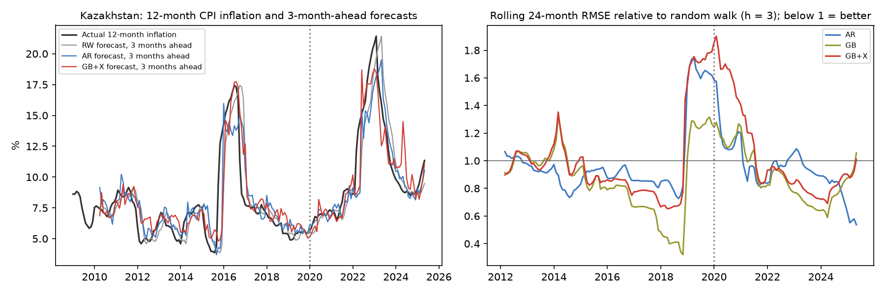

# Can machine learning forecast Kazakhstan's inflation better than simple models?

**Short answer:** a little, and not reliably. Gradient boosted trees beat a random-walk forecast by about 10–25% at most horizons, both before and after 2020. A simple linear autoregressive (AR) model does almost as well, though, and most of the differences are not statistically significant over 15 years of data. Adding the exchange rate and oil prices did **not** help.

This is a small first study by a high school student, inspired by Chen, Gao, Hazell, Lei and Lian, *"Forecasting Inflation with Microdata: An Adaptive Machine Learning Approach"* (preliminary, 2026). Their paper finds that ML forecasts using UK price microdata beat a simple benchmark **only after 2020**. This project asks a simpler version of that question with public aggregate data for an emerging economy.



## Data

| Series | Source | Coverage used |
|---|---|---|
| Consumer price index, Kazakhstan, monthly | IMF International Financial Statistics, via [DBnomics](https://db.nomics.world/IMF/IFS/M.KZ.PCPI_IX) | 2001-01 to 2025-05 |
| Tenge per US dollar, monthly average | IMF IFS, via [DBnomics](https://db.nomics.world/IMF/IFS/M.KZ.ENDA_XDC_USD_RATE) | to 2025-07 |
| Brent crude oil price, monthly | [FRED, POILBREUSDM](https://fred.stlouisfed.org/series/POILBREUSDM) | to 2026-09 |

**Data repair.** The IMF price index has a base-year splice in January 2020: it jumps from 194.27 to 380.06, which looks like 95.6% inflation in one month. Kazakhstan's Bureau of National Statistics reports 0.7% for that month ([January table, stat.gov.kz](https://stat.gov.kz/en/industries/economy/prices/publications/38575/)), so the index is rebuilt with 0.7%. `forecast.py` checks the repaired series against the same table for January 2019 (0.5%) and January 2021 (0.6%), and stops if any month after 2001 moves more than 6%. After the repair, 12-month inflation peaks at 21.4% in February 2023, in line with official figures.

The data end in May 2025 because that is the latest month in the IMF series on DBnomics.

## Method

- **Target:** 12-month CPI inflation h months ahead, for h = 1, 3, 6 and 12.
- **Models**, one fitted directly for each horizon:
  - **RW:** random walk; tomorrow's inflation equals today's (Atkeson and Ohanian, 2001).
  - **AR:** linear regression on current 12-month inflation and the last 3 monthly rates.
  - **GB:** gradient boosted trees (scikit-learn) on the last 12 monthly inflation rates.
  - **GB+X:** the same, plus changes in the exchange rate and oil price over 1, 3 and 12 months.
- **Testing:** pseudo out-of-sample with an expanding window. Each model only uses data that was available on the forecast date. Models are refit every 3 months, and forecasts start in January 2010.
- **Accuracy:** root mean squared error (RMSE), relative to RW, for target months 2010–2019 and 2020–May 2025. Diebold–Mariano tests check whether a model is significantly different from RW.

## Results

RMSE relative to the random walk (below 1 = better than RW). The Diebold–Mariano p-value is in brackets; \* marks p < 0.05.

| Horizon | Period | AR | GB | GB+X |
|---|---|---|---|---|
| 1 month | 2010–2019 | 0.89 (0.18) | **0.82** (0.07) | 0.92 (0.16) |
| 1 month | 2020–2025 | 0.88 (0.005\*) | **0.79** (0.16) | 1.00 (0.99) |
| 3 months | 2010–2019 | 0.89 (0.29) | **0.72** (0.10) | 0.83 (0.13) |
| 3 months | 2020–2025 | 0.88 (0.22) | **0.82** (0.24) | 0.87 (0.33) |
| 6 months | 2010–2019 | 0.78 (0.14) | **0.75** (0.13) | 0.78 (0.15) |
| 6 months | 2020–2025 | 0.85 (0.36) | **0.76** (0.23) | 0.78 (0.22) |
| 12 months | 2010–2019 | **0.78** (0.23) | 0.93 (0.69) | 0.90 (0.51) |
| 12 months | 2020–2025 | 0.84 (0.33) | **0.77** (0.07) | 0.95 (0.77) |

Full numbers are in `results/rmse_table.csv`, and every forecast is in `results/forecasts_h*.csv`.

## What I found

1. **Both AR and gradient boosting beat the random walk at most horizons, by about 10–25%.** Most differences are not statistically significant, though: only one of 24 comparisons has p < 0.05.
2. **Gradient boosting was the most accurate model in 7 of 8 cases, but by little.** Its edge over the AR model is small, and I didn't test whether it's significant.
3. **The exchange rate and oil price did not help.** GB+X was worse than GB everywhere except the 12-month horizon before 2020. This is surprising for an oil exporter with large devaluations (2015). Possible reasons:
   - there are only a few big shocks to learn from
   - the extra features add noise
   - monthly averages hide what matters
4. **There is no clear "ML only helps after 2020" pattern here, unlike the UK microdata paper.** Gains look similar in both periods. That paper uses millions of individual prices; this study uses only aggregate series, so the two results aren't directly comparable.
5. **Every model misses turning points.** At the 2015 devaluation and the 2022–23 surge, all forecasts react late (left chart). The rolling chart also shows that relative accuracy swings a lot over time, so one overall number hides a lot.

## Combining the forecasts

McWilliams, Stewart and Isengildina Massa (*Food Policy*, 2026) find that their random-forest model and a SARIMA benchmark have complementary strengths for U.S. food price inflation, and that a simple average of the two improves accuracy. `combine.py` checks the same idea here, with AVG = (AR + GB) / 2.

RMSE relative to the random walk:

| Horizon | Period | AR | GB | AVG |
|---|---|---|---|---|
| 1 month | 2010–2019 | 0.89 | 0.82 | **0.79** |
| 1 month | 2020–2025 | 0.88 | 0.79 | **0.76** |
| 3 months | 2010–2019 | 0.89 | **0.72** | 0.74 |
| 3 months | 2020–2025 | 0.88 | 0.82 | **0.73** |
| 6 months | 2010–2019 | 0.78 | 0.75 | **0.73** |
| 6 months | 2020–2025 | 0.85 | 0.76 | **0.74** |
| 12 months | 2010–2019 | **0.78** | 0.93 | 0.83 |
| 12 months | 2020–2025 | 0.84 | **0.77** | 0.78 |

The average is the most accurate in 5 of 8 cases, and within 0.05 of the best in the other three. Its advantage is steadier than either model on its own. I have not yet tested whether the average is significantly better than GB alone.

## Limitations

- About 15 years of monthly forecasts, of which only 65 months are after 2020: too little to detect small differences.
- One country, aggregate data only. No microdata, no survey expectations, no central bank policy rate.
- Gradient boosting settings were chosen once and not tuned, to avoid overfitting to the test period. Different settings might do better or worse.
- Forecasts at overlapping horizons are correlated, so the 24 comparisons are not independent.

## Next steps

- Add the National Bank of Kazakhstan's policy rate and survey inflation expectations.
- Try the adaptive combination from Chen et al.: use the ML forecast only when a recent-performance test says it is helping.
- Test the GB-versus-AR difference directly, and repeat for neighbouring economies (e.g. Uzbekistan, Kyrgyzstan).

## Run it

```
python -m pip install pandas numpy scikit-learn matplotlib
python forecast.py
python combine.py
```

The `data/` folder holds the downloaded series, so the results can be reproduced offline.
